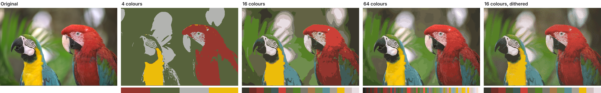

# agglomerative-clustering

**Exact Ward colour quantization for JavaScript. Cluster an image once, then cut it to a palette of any size in under a millisecond.**

[](https://www.npmjs.com/package/agglomerative-clustering)
[](LICENSE)




Most colour quantizers answer one question: *give me k colours*. Ask for a different k and they start over. This library builds the complete merge hierarchy of the image's colours with Ward's method, which merges whichever two colour groups add the least squared error. Every palette size is then a cut of that one tree:

- **Every palette size from one pass.** After clustering, a palette of any size takes about 0.4 ms. A colour-count slider, or a set of 8/16/32/64-colour variants, costs one clustering instead of one per size.
- **Palettes nest, in a stable order.** The 16-colour palette is the 32-colour one with pairs merged. Index 0 is always the dominant colour, and each larger palette is the previous one with one entry refined and one colour appended, so swatches don't jump around as the count changes.
- **Transparency-aware.** Pixels count in proportion to their opacity, so a logo's transparent background never ends up in its palette.
- **Accurate.** Across the 24 Kodak photos it has the lowest average error of the six JavaScript quantizers we benchmarked, at every palette size from 16 to 256.
- **Fast enough to be interactive.** A 768×512 photo takes about 160 ms exact, or about 60 ms with `precision: 6` at the same quality. That is level with libimagequant and 2.6–11× faster than image-q.
- **Small and portable.** 55 KB of WebAssembly with SIMD, Node and browsers, an async API, TypeScript types and no runtime dependencies. Output is deterministic.

**[Try the demo](#demo)**: drop in an image and drag the palette-size slider.

## Install

```sh
npm install agglomerative-clustering
```

## Quick start

```js
import { getPalette, quantize } from 'agglomerative-clustering';

// `image` is ImageData, a raw RGBA Uint8Array, or { data, format: 'rgb' | 'rgba' }
const palette = await getPalette(image, 8);                  // Uint8Array: [r, g, b, r, g, b, ...]
const reduced = await quantize(image, 16, { dither: true }); // same type as the input
```

### Cluster once, cut anywhere

```js
import { getClustering, getPaletteFromClustering, quantizeWithPalette } from 'agglomerative-clustering';

const clustering = await getClustering(imageData);         // the expensive step, done once

slider.oninput = async () => {
    const k = Number(slider.value);
    const palette = await getPaletteFromClustering(clustering, k);   // ~0.4 ms for any k
    const result = await quantizeWithPalette(imageData, palette);    // ~25-40 ms for a 768×512 image
    ctx.putImageData(result, 0, 0);
};
```

The clustering is a compact `Uint8Array` (a 4-byte header plus 9 bytes per distinct colour), so you can cache it or store it next to the image. It records the colour space it was made in, so `quantizeWithClustering` matches in the same space unless you say otherwise.

## How it compares

This table covers the 24 Kodak photos (768×512) at 64 colours. "Error vs ours" is mean squared error relative to this library, so 1.08× means 8% more error. Every palette is mapped to pixels the same way, so palettes are compared like for like. Times are medians per image, in WASM on Node 22.

| Library | PSNR | Error vs ours | One palette | Palettes at 16/64/128/256 |
|---|---|---|---|---|
| **agglomerative-clustering** | **35.72 dB** | **1.00×** | 165 ms | **151 ms** |
| agglomerative-clustering, `precision: 6` | 35.70 dB | 1.00× | 59 ms | 61 ms |
| libimagequant (pngquant's engine) | 35.39 dB | 1.08× | 154 ms | 642 ms |
| image-q Wu | 35.51 dB | 1.05× | 908 ms | 3940 ms |
| image-q NeuQuant | 34.41 dB | 1.35× | 717 ms | 4098 ms |
| MMCQ (color-thief's algorithm) | 32.53 dB | 2.08× | 31 ms | 136 ms |
| image-q RgbQuant | 31.95 dB | 2.38× | 476 ms | 1822 ms |

The `precision: 6` row comes from a separate run on the same machine. Full results at every palette size, on synthetic images too, with ΔE2000 and the method, are in [bench/COMPARISON.md](bench/COMPARISON.md). You can reproduce them with `node bench/run.js`.

## Options

Every function that takes an image also takes an optional last argument of options. They are all off by default, and the defaults give the exact results shown above.

| Option | Applies to | Values | What it does |
|---|---|---|---|
| `precision` | clustering | `1`–`8`, default `8` | Groups colours that share their top `precision` bits per channel before clustering, at their mean colour. **`6` is about 3× faster on photos at practically the same quality** (−0.02 dB), and caps the work on images with huge numbers of colours. `5` is about 8× faster for a small loss. |
| `colorSpace` | clustering and mapping | `'rgb'` (default), `'oklab'` | `'oklab'` clusters and matches in [OKLab](https://bottosson.github.io/posts/oklab/), where distance tracks perceived difference. It gives lower ΔE2000 at 64+ colours and on smooth gradients, at the cost of PSNR. Use it when the result is for human eyes and you want 64 or more colours. At 16 colours, RGB is better. |
| `alpha` | clustering | `'weight'` (default), `'ignore'` | `'weight'` counts each RGBA pixel in proportion to its opacity: fully transparent pixels are ignored, and semi-transparent ones count partially. For opaque images, and images whose pixels are only fully opaque or fully transparent, this is exact pixel counting. `'ignore'` counts every pixel fully, as 1.x did. Alpha is always preserved in the output. |
| `dither` | mapping | `false` (default), `true`, or `0`–`1` | Serpentine Floyd–Steinberg error diffusion, with a strength from 0 to 1. Hides banding in gradients at low colour counts. It scores worse on per-pixel metrics such as PSNR, because the noise is the point. Error is diffused in the chosen `colorSpace`, and fully transparent pixels are left undithered. |
| `width` | mapping | integer | Needed for dithering when the image is a `Uint8Array`, or a `RawImage` without `width`. `ImageData` provides it. |

"Clustering" means `getClustering` and `getPalette`, "mapping" means `quantizeWithClustering` and `quantizeWithPalette`, and `quantize` takes both.

Measured on the Kodak photos:

| Setting | 16 colours ΔE2000 | 256 colours ΔE2000 | One 64-colour palette |
|---|---|---|---|
| default (`rgb`, exact) | **4.31** | 1.68 | 177 ms |
| `precision: 6` | **4.29** | 1.68 | 59 ms |
| `colorSpace: 'oklab', precision: 6` | 4.44 | **1.61** | 109 ms |
| libimagequant, for reference | 4.38 | **1.61** | 169 ms |

```js
// Perceptual palettes for a photo, quickly
const palette = await getPalette(photo, 128, { colorSpace: 'oklab', precision: 6 });

// Retro look: 8 colours, dithered
const retro = await quantize(imageData, 8, { dither: true });

// Dithering a raw buffer needs its width
const out = await quantize(rgbaBytes, 32, { dither: 0.8, width: 640 });
```

## When to use it, and when not

**A good fit:**
- **Interactive tools where people choose the number of colours:** palette editors, posterisers, pixel-art, embroidery, paint-by-number and knitting pattern generators, and LED, e-ink or limited-palette displays.
- **Generating several palette sizes for the same image,** or storing one clustering and cutting it later.
- **When you want the most accurate palette for a given size,** for example as a starting point for vectorisation or flat-colour art.

**Probably not the right tool:**
- **Shrinking PNG files in a build pipeline.** Use [sharp](https://sharp.pixelplumbing.com/) or pngquant, which run libimagequant natively and are tuned for compression.
- **A handful of "dominant" swatches for a UI theme.** [color-thief](https://lokeshdhakar.com/projects/color-thief/) or [node-vibrant](https://github.com/Vibrant-Colors/node-vibrant) are lighter and pick vivid or salient colours rather than the lowest-error ones.
- **Palettes that need their own alpha values,** as palette PNGs with translucent entries do. Pixels are weighted by opacity, but palette colours are opaque RGB, and each pixel keeps its own alpha.

## Usage

### Browser (Canvas)

```js
import { quantize } from 'agglomerative-clustering';

const ctx = canvas.getContext('2d');
const imageData = ctx.getImageData(0, 0, canvas.width, canvas.height);

// ImageData in, ImageData out
const result = await quantize(imageData, 16, { dither: true });
ctx.putImageData(result, 0, 0);
```

### Node.js (with sharp)

```js
import { quantize } from 'agglomerative-clustering';
import sharp from 'sharp';

const { data, info } = await sharp('photo.jpg').ensureAlpha().raw().toBuffer({ resolveWithObject: true });
const image = { data: new Uint8Array(data.buffer, data.byteOffset, data.length), format: 'rgba', width: info.width };

const { data: output } = await quantize(image, 32, { precision: 6, dither: true });

await sharp(Buffer.from(output), { raw: { width: info.width, height: info.height, channels: 4 } }).toFile('photo-32.png');
```

## Input types

Every function that takes an image accepts:

```ts
Uint8Array                                   // raw RGBA bytes
ImageData                                    // from a canvas: always RGBA, width included
{ data: Uint8Array | Uint8ClampedArray,      // explicit format, for RGB data or clamped arrays
  format: 'rgb' | 'rgba',
  width?: number, height?: number }          // optional: used for dithering, copied to results
```

The `quantize*` functions return the same type they were given: a `Uint8Array` for a `Uint8Array`, `ImageData` for `ImageData`, and an object with the same `format` (plus `width`/`height` if given) for an object.

## API

### `getClustering(image, options?): Promise<Uint8Array>`
Builds the colour hierarchy for an image. Options: `colorSpace`, `precision`, `alpha`. Pass the result to `getPaletteFromClustering` or `quantizeWithClustering` to get any number of palettes without clustering again.

### `getPaletteFromClustering(clustering, k): Promise<Uint8Array>`
Cuts a clustering to at most `k` colours, returned as flat RGB bytes. This takes well under a millisecond. Colours come in split order: index 0 is the dominant colour, and the palette for `k + 1` is the palette for `k` with one entry refined (the larger half of a split keeps its parent's place) and the smaller half appended. Accepts clusterings from 1.x too.

### `getPalette(image, k, options?): Promise<Uint8Array>`
`getClustering` followed by `getPaletteFromClustering`. Options: `colorSpace`, `precision`, `alpha`.

### `quantize(image, k, options?): Promise<Uint8Array | ImageData | RawImage>`
Reduces the image to at most `k` colours. Options: `colorSpace`, `precision`, `alpha`, `dither`, `width`.

### `quantizeWithClustering(image, clustering, k, options?)`
Quantizes using a clustering you already have. Options: `colorSpace` (defaults to the clustering's), `dither`, `width`.

### `quantizeWithPalette(image, palette, options?)`
Maps each pixel to its nearest colour in any palette (flat RGB bytes). The result doesn't depend on the palette's order: equally near colours are decided by their RGB value. Options: `colorSpace`, `dither`, `width`.

### `init(): Promise<void>`
Loads the WebAssembly module. Every other function does this on first use, so calling it is optional, for example to warm up before a batch.

Invalid inputs, palette sizes and options (including unknown option names) are rejected with a descriptive error.

## Migrating from 1.x

2.0 keeps the same functions and defaults (`rgb`, no dithering, exact `precision`). What changes:

- **Palette order.** Palettes come in split order, dominant colour first, rather than in an arbitrary order. For opaque images they contain exactly the same colours as 1.2.
- **Transparency.** RGBA pixels are weighted by opacity, so palettes of images with transparency change: fully transparent pixels no longer contribute. Pass `{ alpha: 'ignore' }` for the 1.x behaviour.
- **Clustering bytes.** Clusterings gain a 4-byte header recording their colour space and precision. Clusterings saved by 1.x still load. Anything that inspected the raw bytes needs to skip the header.
- **`quantizeWithClustering`** matches in the clustering's colour space unless you pass `colorSpace`.
- **Exact ties** in pixel mapping go to the colour with the smaller RGB value, so results don't depend on palette order. A small number of pixels that sit exactly between two palette colours may map differently from 1.2.
- **Invalid clusterings** passed to `getPaletteFromClustering` or `quantizeWithClustering` now throw instead of giving an empty palette.

## Demo

```sh
git clone https://github.com/RohanFredriksson/agglomerative-clustering && cd agglomerative-clustering
npm install && npm run build   # building needs Emscripten (em++) on your PATH
npm run demo                   # then open http://localhost:8080/demo/
```

The demo clusters an image once, then re-cuts and re-maps it live as you drag the palette-size and dithering sliders. You can switch colour space and precision, and drop in your own images.

## How it works

1. **Histogram.** Distinct colours are counted with an open-addressing hash table. With `precision` below 8, colours are first grouped by their top bits.
2. **Exact Ward clustering.** A nearest-neighbour chain finds mutually cheapest pairs and merges them. Ward's criterion is reducible, so this produces exactly the same hierarchy as repeatedly merging the globally cheapest pair, without a priority queue.
3. **Fast partner search.** Clusters live in an adaptive 3D grid sized to the occupied part of colour space, with per-column occupancy bits so searches step over empty cells. Searches prune whole cells using each cell's colour box and lightest member, compute four Ward costs at once with WASM SIMD, and skip most candidates with a division-free float test before the exact double-precision check. Clusters whose searches are expensive cache their best candidates.
4. **Compact output.** The hierarchy is stored as a 4-byte header and 9-byte merge records in reverse order, each listing its heavier half first. Cutting to `k` colours replays the first `k − 1` records, which gives the stable split order.
5. **Mapping.** A memo of recent colours, then a grid over colour space whose cells list the palette entries that can be nearest there (a KD-tree for palettes above 256 colours), maps pixels to the palette, with optional error-diffusion dithering.

The algorithm is C++17 compiled to WebAssembly with Emscripten. Architecture notes for contributors are in [CLAUDE.md](CLAUDE.md).

## License

MIT © Rohan Fredriksson
