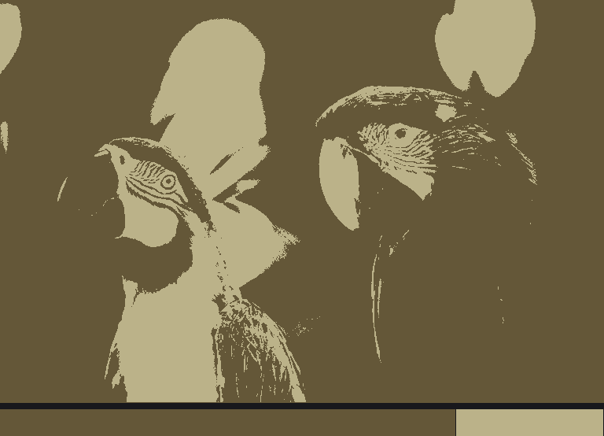
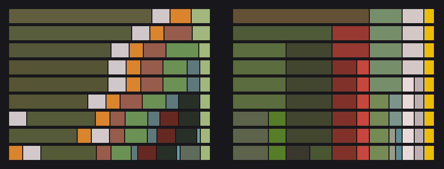
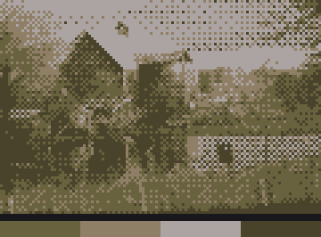
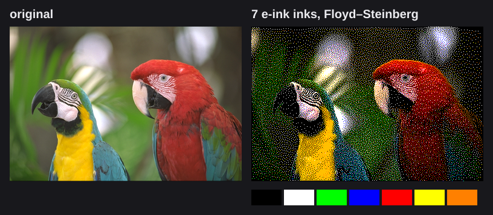
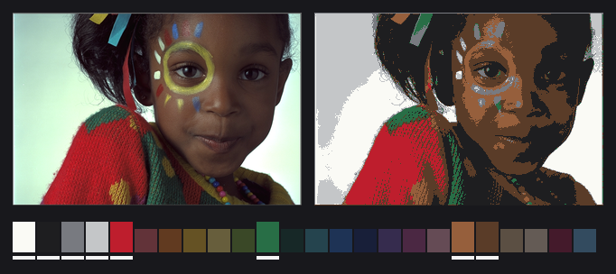
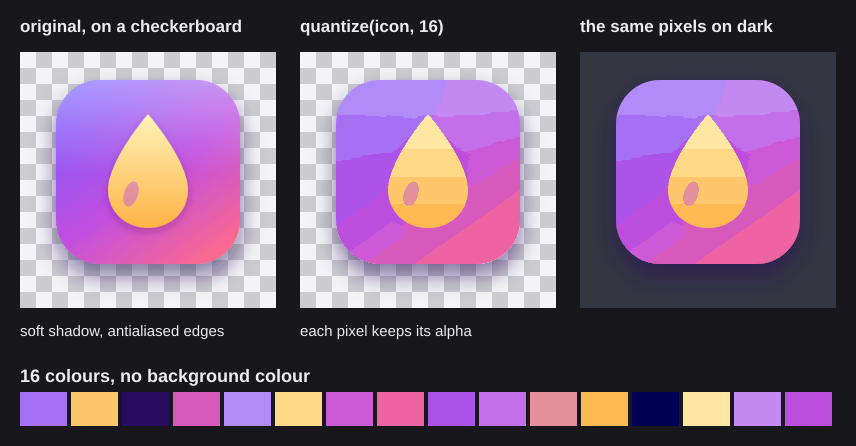
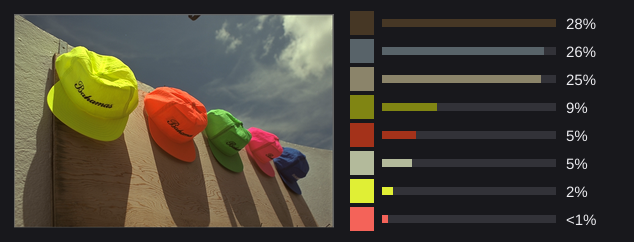
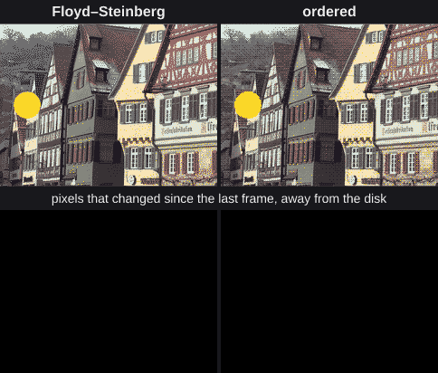

# agglomerative-clustering

**Exact Ward colour quantization for JavaScript. Cluster an image once, then cut it to a palette of any size in under a millisecond.** Palettes of different sizes nest, so a colour-count slider, a set of 8, 16, 32 and 64 colour versions, or an error curve cost one clustering, not one per size.

[](https://www.npmjs.com/package/agglomerative-clustering)
[](LICENSE)




*Every palette size from one clustering, in 115 ms (a 768×512 photo, 2 to 64 colours, including all 63 cuts).* <!-- docs/media/results.json: hero.totalMs, median of 5, measured on 4.3.0 -->

## Why this one

Most colour quantizers answer one question: *give me k colours*. Ask for a different k and they start over. This one builds the whole tree of an image's colours once, and a palette of any size is a cut of it.

1. **Every palette size from one pass, and the palettes nest.** The 16-colour palette is the 32-colour one with pairs merged, so swatches don't jump around as the count changes. A cut takes under a millisecond<!-- docs/media/results.json: hero.cutsMs, 4.1 ms for 63 cuts -->. Median cut starts over for each k:

   

   *Other quantizers start over for each k (here MMCQ, color-thief's median cut, in the order it returns); these palettes nest.*

2. **The lowest error of the libraries benchmarked, at 64 colours and up.** On the 24 Kodak photos at 64, 128 and 256 colours, no other library has lower mean squared error on any photo; at 64 the nearest, image-q Wu, has 1.05× ours. At 16 colours Wu and libimagequant do better on a few photos (4 and 5 of 24), by up to 4.2%. See [Benchmarks](#benchmarks). <!-- bench/COMPARISON.md Summary and Kodak tables, from bench/results-4.3.0.json -->
3. **It knows the image.** Each colour's share of the pixels (`buildSwatches`), the error at every palette size, so you can pick a size from an error target (`getClusteringInfo`), and the best fit of `k` entries from a fixed palette such as a thread chart (`chooseFrom`).
4. **Real-world input.** Transparency (a logo's background never ends up in its palette), premultiplied canvas pixels, BGRA and other pixel layouts, and a worker entry that keeps the page responsive.
5. **Runs everywhere.** Node and browsers, about 42 KB of WebAssembly gzipped<!-- gzip -9 of dist/clustering.wasm at 4.3.0: 42,862 bytes, bench/spikes/slicing-mapping/results-size.txt -->, no dependencies, deterministic output.

## Install

```sh
npm install agglomerative-clustering
```

It runs on Node 22.12+, and in browsers with WebAssembly SIMD (Chrome and Edge 91, Firefox 89, Safari 16.4). Deno, Bun, Cloudflare Workers, serverless functions, Electron and browser extensions work too: see [Environments](https://github.com/RohanFredriksson/agglomerative-clustering/blob/master/docs/environments.md).

Upgrading? See [Migrating](https://github.com/RohanFredriksson/agglomerative-clustering/blob/master/docs/migrating.md).

## Examples

**In Node, with [sharp](https://sharp.pixelplumbing.com/):**

```js
import sharp from 'sharp';
import { buildPalette, quantize } from 'agglomerative-clustering';

const { data, info } = await sharp('photo.jpg').rotate().ensureAlpha().raw().toBuffer({ resolveWithObject: true });
const image = { data, format: 'rgba', width: info.width };   // in TypeScript: format: 'rgba' as const

const palette = await buildPalette(image, 8);                   // flat bytes: [r, g, b, r, g, b, ...]
const reduced = await quantize(image, 16, { dither: true });  // the image, in 16 colours

await sharp(Buffer.from(reduced.data), { raw: { width: info.width, height: info.height, channels: 4 } }).toFile('photo-16.png');
```

**In the browser, with a canvas:**

```js
import { quantize } from 'agglomerative-clustering';

const ctx = canvas.getContext('2d');
const imageData = ctx.getImageData(0, 0, canvas.width, canvas.height);

ctx.putImageData(await quantize(imageData, 16, { dither: true }), 0, 0);   // ImageData in, ImageData out
```

**Swatches, with each colour's share of the image:**

```js
import { buildSwatches } from 'agglomerative-clustering';

const { palette, shares } = await buildSwatches(imageData, 6);   // six colours; the shares sum to 1
shares.forEach((share, i) => {
  console.log(`rgb(${palette[3 * i]} ${palette[3 * i + 1]} ${palette[3 * i + 2]})`, `${(share * 100).toFixed(1)}%`);
});
```

Entries keep their place as `k` grows (split order), so palettes nest. For hex strings, the largest share first or a dominant colour, see [Heaviest first](docs/guides.md#heaviest-first).

**A colour-count slider:** cluster once, then cut and map as often as you like.

```js
import { buildClustering, quantizeWithPalette } from 'agglomerative-clustering';

const clustering = await buildClustering(imageData);                   // the expensive step, done once

slider.oninput = async () => {
  const palette = await clustering.getPalette(Number(slider.value));        // under 1 ms for any k
  ctx.putImageData(await quantizeWithPalette(imageData, palette), 0, 0);   // a few ms at 768×512
};
```

Input is decoded pixels (a bare `Uint8Array` of RGBA bytes, an `ImageData`, or `{ data, format, width?, height? }`): the formats, where pixels come from and how premultiplied alpha works are in the [API reference](https://github.com/RohanFredriksson/agglomerative-clustering/blob/master/docs/api.md#input), and [decoding image files](https://github.com/RohanFredriksson/agglomerative-clustering/blob/master/docs/guides.md#decoding-image-files) has a recipe for Node, browsers and edge runtimes. For a page that stays responsive while it clusters, use `agglomerative-clustering/worker` (see [Workers](https://github.com/RohanFredriksson/agglomerative-clustering/blob/master/docs/guides.md#workers)).

## Gallery

What people build with it. Each card has the code that makes it, and a guide.

### Pixel art and posterising



One photo at 4, 8, 16 and 32 colours, ordered dithering. The clustering is built once; each size is a cut and a map.

<!-- snippet pixelart -->
```js
import { buildClustering } from 'agglomerative-clustering';

const clustering = await buildClustering(image);
const sizes = [4, 8, 16, 32];
const frames = await Promise.all(sizes.map((k) => clustering.quantizeToIndices(image, k, { dither: 'ordered' })));
frames;
```

Guides: [GIFs and palette PNGs](https://github.com/RohanFredriksson/agglomerative-clustering/blob/master/docs/guides.md#gifs-and-palette-pngs); [choosing a dither method](https://github.com/RohanFredriksson/agglomerative-clustering/blob/master/docs/api.md#choosing-a-dither-method) for the ordered method.

### E-ink and limited displays



The photo beside its rendering in seven inks, Floyd–Steinberg. The picture uses the `ditherInLight` recipe, which mixes in light, as the panel does; the code below is the plain call, and `ditherInLight` is a drop-in replacement for it.

<!-- snippet eink -->
```js
import { quantizeToIndicesWithPalette } from 'agglomerative-clustering';

const inks = new Uint8Array([0,0,0, 255,255,255, 0,255,0, 0,0,255, 255,0,0, 255,255,0, 255,128,0]);   // black white green blue red yellow orange
const { indices } = await quantizeToIndicesWithPalette(image, inks, { dither: 'floyd-steinberg' });   // one entry of `inks` per pixel
indices;
```

Guides: [Fixed palettes](https://github.com/RohanFredriksson/agglomerative-clustering/blob/master/docs/guides.md#fixed-palettes-e-ink-thread-bricks); the recipe: [Dithering to a few inks: mix in light](https://github.com/RohanFredriksson/agglomerative-clustering/blob/master/docs/api.md#dithering-to-a-few-inks-mix-in-light).

### Threads, bricks, paint-by-number



`chooseFrom` picks the 12 entries of a fixed set (here 24 illustrative colours, not a real chart) that best fit the photo.

<!-- snippet threads -->
```js
import { buildClustering, quantizeToIndicesWithPalette } from 'agglomerative-clustering';

const clustering = await buildClustering(image);
const choice = await clustering.chooseFrom(chart, 12);   // chart: a flat RGB Uint8Array of the colours you can buy
const { indices } = await quantizeToIndicesWithPalette(image, choice.palette);   // choice.indices: positions in `chart`
indices;
```

Guide: [Fixed palettes](https://github.com/RohanFredriksson/agglomerative-clustering/blob/master/docs/guides.md#fixed-palettes-e-ink-thread-bricks), with a stitch count for the shopping list.

### Transparency



An app icon with a soft shadow, reduced to 24 colours. The shadow does not take palette entries, and each pixel keeps its own alpha, so the result sits on any background.<!-- docs/media/results.json: transparency --> The gallery's GIFs are the library's own `quantizeToIndices` output, written with gifenc: see the [GIF and palette PNG recipe](https://github.com/RohanFredriksson/agglomerative-clustering/blob/master/docs/guides.md#gifs-and-palette-pngs).

<!-- snippet transparency -->
```js
import { quantize } from 'agglomerative-clustering';

const reduced = await quantize(image, 24, { dither: 0.5 });   // same type back, each pixel's alpha kept
reduced;
```

Docs: [Transparency](https://github.com/RohanFredriksson/agglomerative-clustering/blob/master/docs/api.md#transparency).

### Swatches for design tools



`buildSwatches` gives the palette and each colour's share of the image, ready for bars or a legend.

<!-- snippet swatches -->
```js
import { buildSwatches } from 'agglomerative-clustering';

const { palette, shares } = await buildSwatches(image, 8);   // the shares sum to 1
shares;
```

Guide: [Swatches and choosing a palette size](https://github.com/RohanFredriksson/agglomerative-clustering/blob/master/docs/guides.md#swatches-and-choosing-a-palette-size).

### Animation: ordered dithering keeps still areas still



One palette for the clip, then ordered dithering: a pixel's colour depends only on its colour and position, so still areas stay still. With Floyd–Steinberg, 4.1% of the pixels away from the ball changed in each frame; with ordered, 0%.<!-- docs/media/results.json: animation.pixelsChangedAwayFromBallPercent -->

<!-- snippet animation -->
```js
import { buildClustering, quantizeToIndicesWithPalette } from 'agglomerative-clustering';

const palette = await (await buildClustering(image)).getPalette(12);   // one palette for every frame
const frame = await quantizeToIndicesWithPalette(image, palette, { dither: 'ordered' });   // repeat for each frame
frame;
```

Guides: [Animated GIFs and sets of images](https://github.com/RohanFredriksson/agglomerative-clustering/blob/master/docs/guides.md#animated-gifs-and-sets-of-images), [video frames](https://github.com/RohanFredriksson/agglomerative-clustering/blob/master/docs/guides.md#live-video-and-camera-frames).

## Benchmarks

The 24 Kodak photos (768×512) at 64 colours. "Error vs ours" is mean squared error relative to this library, so 1.08× means 8% more error. Every palette is mapped to pixels the same way, so palettes are compared like for like. Times are medians per image, in WASM on Node 24 on a laptop (Intel Core i7-1185G7), for version 4.3.0. <!-- bench/results-4.3.0.json, summarised in bench/COMPARISON.md -->

| Library | PSNR | Error vs ours | One palette | Palettes at 16/64/128/256 |
|---|---|---|---|---|
| **agglomerative-clustering** | **35.72 dB** | **1.00×** | 53 ms | **53 ms** |
| agglomerative-clustering, `precision: 6` | 35.70 dB | 1.00× | 18 ms | 18 ms |
| libimagequant (pngquant's engine) | 35.39 dB | 1.08× | 64 ms | 262 ms |
| image-q Wu | 35.51 dB | 1.05× | 433 ms | 1989 ms |
| image-q NeuQuant | 34.41 dB | 1.35× | 361 ms | 2147 ms |
| MMCQ (color-thief's algorithm) | 32.53 dB | 2.08× | 20 ms | 82 ms |
| image-q RgbQuant | 31.95 dB | 2.38× | 194 ms | 791 ms |

All rows are from one run. Full results at every palette size, on synthetic images too, with ΔE2000 and the method, are in [bench/COMPARISON.md](https://github.com/RohanFredriksson/agglomerative-clustering/blob/master/bench/COMPARISON.md); reproduce them with `node bench/run.js`. These numbers are a snapshot, so expect them to move with the hardware and the versions.

**Large photos.** Clustering a photo with about 150,000 to 350,000 distinct colours takes 0.5 to 1.2 s at full precision and 0.14 to 0.29 s with `precision: 6`; 4.3 is 1.5% to 20.7% faster than 4.2 at full precision in RGB on these, with identical output<!-- bench/spikes/perf-4/results/results-release.txt -->.

## How it works

```
 image ──▶ buildClustering ──▶ a clustering ──▶ cut to k colours ──▶ a palette ──▶ map the pixels ──▶ reduced image
           once, the slow step bytes you can     under 1 ms,          flat RGB       a few ms,
                               store             any k                bytes          any palette
```

The one-shot functions (`buildPalette`, `quantize`, …) do every step for you. To try many palette sizes, call `buildClustering` once and cut it as often as you like.

| You want | from the image | from a clustering you hold¹ | with a palette you supply |
|---|---|---|---|
| a palette (flat RGB) | `buildPalette` | `clustering.getPalette(k)` | |
| a palette with each colour's share | `buildSwatches` | `clustering.getSwatches(k)` | |
| the image reduced to those colours | `quantize` | `clustering.quantize(image, k)` | `quantizeWithPalette` |
| palette indices (GIF, PNG-8) | `quantizeToIndices` | `clustering.quantizeToIndices(image, k)` | `quantizeToIndicesWithPalette` |
| its error curve, for choosing a palette size | | `clustering.getClusteringInfo()` | |
| the `k` entries of a fixed palette (threads, bricks) that best fit | | `clustering.chooseFrom(palette, k)` | |

A clustering you hold has **methods** that take the colours from it, and **`…WithPalette`** takes colours you supply; with neither, the image is clustered for you. `buildClustering` builds a clustering, and `init` loads the WebAssembly module (optional). Most code only needs the first column.

The names say how much work a call does (`build…` clusters, `get…` cuts what you hold, `quantize…` maps pixels): see [Naming](https://github.com/RohanFredriksson/agglomerative-clustering/blob/master/docs/api.md#naming).

¹ A clustering from storage is plain bytes: wrap it with `new Clustering(bytes)` to get the methods back, or off the thread load it with `worker.load(bytes)`. See [Clustering methods](https://github.com/RohanFredriksson/agglomerative-clustering/blob/master/docs/api.md#clustering-methods).

Palettes come in **split order**: the palette for `k + 1` is the one for `k` with one colour split in two, so entries keep their place as `k` grows (they are not sorted by share). The options are `precision` (6 is about 3× faster at practically the same quality), `colorSpace` (`'rgb'` or `'oklab'`), `alpha`, `transparent`, `dither` (Floyd–Steinberg, Atkinson, or ordered for animation, which keeps still areas still), `width`, `signal` and `onProgress`: see the [API reference](https://github.com/RohanFredriksson/agglomerative-clustering/blob/master/docs/api.md).

## When something else fits better

The gallery is where this library does well: tools where people choose the number of colours, several sizes of one image, and the most accurate palette for a given size. It is the wrong tool for these:

- **Shrinking PNG files in a build pipeline.** Use [sharp](https://sharp.pixelplumbing.com/) or pngquant, which run libimagequant natively and are tuned for compression.
- **A handful of vivid "dominant" swatches for a UI theme.** [color-thief](https://lokeshdhakar.com/projects/color-thief/) or [node-vibrant](https://github.com/Vibrant-Colors/node-vibrant) are lighter and pick vivid or salient colours rather than the lowest-error ones.
- **Palettes that need their own alpha values,** as palette PNGs with translucent entries do. Pixels are weighted by opacity, but palette colours are opaque RGB, and each pixel keeps its own alpha.

## Documentation

- **[Guides](https://github.com/RohanFredriksson/agglomerative-clustering/blob/master/docs/guides.md):** swatches and choosing a palette size, GIFs and palette PNGs, animations, live video, workers, fixed palettes (e-ink, thread, bricks), batches of images, converting the output, and moving from color-thief, node-vibrant or image-q.
- **[API reference](https://github.com/RohanFredriksson/agglomerative-clustering/blob/master/docs/api.md):** input formats, options, choosing a colour space, transparency, `Palette` and `Clustering`, cancelling and progress, errors, the worker entry, TypeScript, and every function.
- **[Environments](https://github.com/RohanFredriksson/agglomerative-clustering/blob/master/docs/environments.md):** CDNs, Deno, Bun, Cloudflare Workers, serverless functions, Next.js, Angular and other bundlers, Electron, browser extensions, plugin hosts, pnpm and Yarn, and testing.
- **[Performance and limits](https://github.com/RohanFredriksson/agglomerative-clustering/blob/master/docs/performance.md):** servers and worker pools, memory, and large images.
- **[Troubleshooting](https://github.com/RohanFredriksson/agglomerative-clustering/blob/master/docs/troubleshooting.md):** what an error or a surprising result means, and what to do.
- **[Migrating](https://github.com/RohanFredriksson/agglomerative-clustering/blob/master/docs/migrating.md)** from 3.x, 2.x and 1.x, and the [CHANGELOG](https://github.com/RohanFredriksson/agglomerative-clustering/blob/master/CHANGELOG.md).
- **[Stability and versioning](https://github.com/RohanFredriksson/agglomerative-clustering/blob/master/docs/stability.md):** what won't change within a major version.
- **[How the algorithm works](https://github.com/RohanFredriksson/agglomerative-clustering/blob/master/docs/how-it-works.md)**, with architecture notes for contributors in [CLAUDE.md](https://github.com/RohanFredriksson/agglomerative-clustering/blob/master/CLAUDE.md).
- **[Media credits](https://github.com/RohanFredriksson/agglomerative-clustering/blob/master/docs/media/CREDITS.md)**: the gallery images are made by `docs/media/make.mjs` from the library itself.
- **[Roadmap](https://github.com/RohanFredriksson/agglomerative-clustering/blob/master/docs/ROADMAP.md):** what is planned, and what was tried and dropped.

## Demo

```sh
git clone https://github.com/RohanFredriksson/agglomerative-clustering && cd agglomerative-clustering
scripts/setup-emsdk.sh && source ~/.local/share/emsdk/emsdk_env.sh   # Emscripten, the version CI uses
npm install && npm run build
npm run demo                   # then open http://localhost:8080/demo/
```

The demo clusters an image once, then re-cuts and re-maps it live as you drag the palette-size and dithering sliders.

## License

MIT © Rohan Fredriksson
