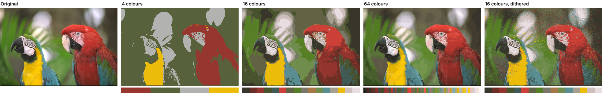

# agglomerative-clustering

**Exact Ward colour quantization for JavaScript. Cluster an image once, then cut it to a palette of any size in under a millisecond.**

[](https://www.npmjs.com/package/agglomerative-clustering)
[](LICENSE)




Most colour quantizers answer one question: *give me k colours*. Ask for a different k and they start over. This library clusters an image's colours once, into a complete tree, and every palette size is then a cheap cut of that tree. A colour-count slider, or a set of 8, 16, 32 and 64 colour versions, costs one clustering instead of one per size.

- **Every palette size from one pass.** Clustering a photo takes about 100 ms. After that, a palette of any size takes about 0.4 ms.
- **Palettes nest, in a stable order.** The 16-colour palette is the 32-colour one with pairs merged, so swatches don't jump around as the count changes.
- **It knows each colour's share of the image,** so you can show swatches with percentages, or pick the smallest palette that meets an error target.
- **Transparency-aware.** A logo's transparent background never ends up in its palette. GIF and palette PNG output are built in.
- **Off the main thread.** `agglomerative-clustering/worker` runs the same API in a Web Worker or Node worker thread.
- **Accurate and fast.** The lowest average error of the six JavaScript quantizers we benchmarked, at about the speed of libimagequant ([numbers](#how-it-compares)).
- **Small and portable.** 88 KB of WebAssembly, Node and browsers, TypeScript types, no runtime dependencies, deterministic output.

[Install](#install) · [Quick start](#quick-start) · [The idea](#the-idea-in-one-minute) · [Guides](#guides) · [Reference](#reference) · [API](#api) · [Troubleshooting](#troubleshooting)

## Install

```sh
npm install agglomerative-clustering
```

It runs on Node 20.19+ and 22.12+, and in browsers with WebAssembly SIMD (see [Where it runs](#where-it-runs)).

## Quick start

**In Node, with [sharp](https://sharp.pixelplumbing.com/):**

```js
import sharp from 'sharp';
import { getPalette, quantize } from 'agglomerative-clustering';

const { data, info } = await sharp('photo.jpg').ensureAlpha().raw().toBuffer({ resolveWithObject: true });
const image = { data: new Uint8Array(data.buffer, data.byteOffset, data.length), format: 'rgba', width: info.width };

const palette = await getPalette(image, 8);                   // flat bytes: [r, g, b, r, g, b, ...]
const reduced = await quantize(image, 16, { dither: true });  // the image, in 16 colours

await sharp(Buffer.from(reduced.data), { raw: { width: info.width, height: info.height, channels: 4 } }).toFile('photo-16.png');
```

**In the browser, with a canvas:**

```js
import { quantize } from 'agglomerative-clustering';

const ctx = canvas.getContext('2d');
const imageData = ctx.getImageData(0, 0, canvas.width, canvas.height);

ctx.putImageData(await quantize(imageData, 16, { dither: true }), 0, 0);   // ImageData in, ImageData out
```

**Swatches, with each colour's share of the image:**

```js
import { getSwatches } from 'agglomerative-clustering';

const { palette, shares } = await getSwatches(imageData, 6);   // six colours; the shares sum to 1
shares.forEach((share, i) => {
  console.log(`rgb(${palette[3 * i]} ${palette[3 * i + 1]} ${palette[3 * i + 2]})`, `${(share * 100).toFixed(1)}%`);
});
```

Those three are all you need to get started. The rest of this page is organised by what you want to do (the [guides](#guides)) and by what to look up (the [reference](#reference) and the [API](#api)).

## The idea in one minute

```
 image ──▶ getClustering ──▶ a clustering ──▶ cut to k colours ──▶ a palette ──▶ map the pixels ──▶ reduced image
           once, ~100 ms     bytes you can     under 1 ms,          flat RGB       a few ms,
                             store             any k                bytes          any palette
```

The one-shot functions (`getPalette`, `quantize`, …) do the first steps for you. To try many palette sizes, call `getClustering` once and cut it as often as you like.

| You want | from the image | from a clustering you hold | with a palette you supply |
|---|---|---|---|
| a palette (flat RGB) | `getPalette` | `getPaletteFromClustering` | |
| a palette with each colour's share | `getSwatches` | `getSwatchesFromClustering` | |
| the image reduced to those colours | `quantize` | `quantizeFromClustering` | `quantizeWithPalette` |
| palette indices (GIF, PNG-8) | `quantizeToIndices` | `quantizeToIndicesFromClustering` | `quantizeToIndicesWithPalette` |

The names follow one rule: **`…FromClustering`** derives the colours from a clustering you already hold, and **`…WithPalette`** takes colours you supply. With neither, the image is clustered for you. `getClustering` builds the clustering to hold, `getClusteringInfo` reads one, and `init` loads the WebAssembly module (optional). Most code only needs the first column.

Four words are used throughout:

- **clustering**: the tree of an image's colours. It is opaque bytes (a `Clustering`) that you can store next to the image.
- **palette**: flat RGB bytes, `[r, g, b, r, g, b, …]`, with at most **k** colours. A `Palette` knows the colour space it was made in.
- **split order**: palettes come out so that the palette for `k + 1` is the one for `k` with one colour split in two. Entries keep their place as `k` grows, but the palette is not sorted by share.
- **precision**: an option that groups similar colours before clustering, about 3× faster at practically the same quality.

## Is it the right tool?

**A good fit:**
- **Interactive tools where people choose the number of colours:** palette editors, posterisers, pixel art, embroidery, paint-by-number and knitting pattern generators, and LED, e-ink or limited-palette displays.
- **Several palette sizes for the same image,** or storing one clustering and cutting it later.
- **The most accurate palette for a given size,** for example as a starting point for vectorisation or flat-colour art.

**Probably not the right tool:**
- **Shrinking PNG files in a build pipeline.** Use [sharp](https://sharp.pixelplumbing.com/) or pngquant, which run libimagequant natively and are tuned for compression.
- **A handful of "dominant" swatches for a UI theme.** [color-thief](https://lokeshdhakar.com/projects/color-thief/) or [node-vibrant](https://github.com/Vibrant-Colors/node-vibrant) are lighter and pick vivid or salient colours rather than the lowest-error ones.
- **Palettes that need their own alpha values,** as palette PNGs with translucent entries do. Pixels are weighted by opacity, but palette colours are opaque RGB, and each pixel keeps its own alpha.

### How it compares

The 24 Kodak photos (768×512) at 64 colours. "Error vs ours" is mean squared error relative to this library, so 1.08× means 8% more error. Every palette is mapped to pixels the same way, so palettes are compared like for like. Times are medians per image, in WASM on Node 22.

| Library | PSNR | Error vs ours | One palette | Palettes at 16/64/128/256 |
|---|---|---|---|---|
| **agglomerative-clustering** | **35.72 dB** | **1.00×** | 97 ms | **99 ms** |
| agglomerative-clustering, `precision: 6` | 35.70 dB | 1.00× | 31 ms | 31 ms |
| libimagequant (pngquant's engine) | 35.39 dB | 1.08× | 134 ms | 552 ms |
| image-q Wu | 35.51 dB | 1.05× | 740 ms | 3387 ms |
| image-q NeuQuant | 34.41 dB | 1.35× | 609 ms | 3461 ms |
| MMCQ (color-thief's algorithm) | 32.53 dB | 2.08× | 24 ms | 120 ms |
| image-q RgbQuant | 31.95 dB | 2.38× | 385 ms | 1535 ms |

The `precision: 6` row comes from a separate run on the same machine. Full results at every palette size, on synthetic images too, with ΔE2000 and the method, are in [bench/COMPARISON.md](bench/COMPARISON.md); reproduce them with `node bench/run.js`. These numbers are a snapshot, so expect them to move with the hardware and the versions.

## Guides

### Cluster once, cut anywhere

```js
import { getClustering, getPaletteFromClustering, quantizeWithPalette } from 'agglomerative-clustering';

const clustering = await getClustering(imageData);         // the expensive step, done once

slider.oninput = async () => {
  const k = Number(slider.value);
  const palette = await getPaletteFromClustering(clustering, k);   // ~0.4 ms for any k
  const result = await quantizeWithPalette(imageData, palette);    // ~5-12 ms for a 768×512 image
  ctx.putImageData(result, 0, 0);
};
```

A clustering is a `Uint8Array` you can cache or store next to the image: a 22-byte header plus 21 bytes per distinct colour, about 1.3 MB for a 768×512 photo, or 0.45 MB with `precision: 6`. It records the colour space it was made in, and its format is versioned: later releases keep reading it, and older ones say so rather than misreading a newer one. Storage gives plain bytes back, so restore the type with `new Clustering(bytes)` (see [Palette and Clustering](#palette-and-clustering)).

### Swatches, and choosing a palette size

```js
import { getSwatches, getClustering, getSwatchesFromClustering, getClusteringInfo } from 'agglomerative-clustering';

// Colours with their share of the image, in one call
const { palette, weights, shares } = await getSwatches(image, 8);
// palette: flat RGB bytes, weights: pixels per colour, shares: each colour's share of the image (they sum to 1)

// Or cluster once and cut it as often as you like (well under a millisecond each)
const clustering = await getClustering(image);
const eight = await getSwatchesFromClustering(clustering, 8);

// The smallest palette that keeps 99% of the image's colour variance (works the same in 'rgb' and 'oklab')
const { explained } = await getClusteringInfo(clustering);
const k = explained.findIndex((share) => share >= 0.99) + 1;
```

### GIFs and palette PNGs

`quantizeToIndices` returns a palette and one index per pixel, which is what these formats store. With `transparent`, pixels below an alpha cutoff get their own transparent entry, and `k` counts that entry, so 256 is the most a GIF holds.

**A GIF** with [gifenc](https://github.com/mattdesl/gifenc), keeping a transparent background:

```js
import { GIFEncoder } from 'gifenc';   // in plain Node ESM: import gifenc from 'gifenc'; const { GIFEncoder } = gifenc;
import { quantizeToIndices } from 'agglomerative-clustering';

// k counts the transparent entry, so 256 is the most a GIF holds. `image` is { data, format: 'rgba', width, height }.
const { palette, indices, transparentIndex } = await quantizeToIndices(image, 256, { transparent: true });
const colors = Array.from({ length: palette.length / 3 }, (_, i) => [palette[3 * i], palette[3 * i + 1], palette[3 * i + 2]]);

const gif = GIFEncoder();
gif.writeFrame(indices, image.width, image.height, { palette: colors, transparent: transparentIndex !== null, transparentIndex: transparentIndex ?? 0 });
gif.finish();
const bytes = gif.bytes();
```

**A palette PNG** with [fast-png](https://github.com/image-js/fast-png): the same call, then give the transparent entry alpha 0:

```js
import { encode } from 'fast-png';

const png = encode({
  width: image.width, height: image.height, data: indices, depth: 8, channels: 1,
  palette: colors.map((color, i) => [...color, i === transparentIndex ? 0 : 255]),
});
```

`indices` is a `Uint8Array` here because there are at most 256 entries; with more, it is a `Uint16Array` and these formats can't hold it (check `indexBits`). Anti-aliased edges snap to transparent or opaque at the `transparent` cutoff, which is all a GIF can say. To map more frames with the same colours, pass the result's `colors` (the palette without the transparent entry) to `quantizeToIndicesWithPalette`.

### Off the main thread

Clustering a photo takes about 100 ms, too long to run on a page's main thread while someone drags a slider. The worker entry has the same functions, run in a Web Worker (or a worker thread in Node):

```js
import { quantize } from 'agglomerative-clustering/worker';   // same API, one shared worker
const reduced = await quantize(imageData, 16);
```

For live re-cutting, `createWorker().cluster(image)` keeps the image and its clustering in the worker, so each new palette size sends only `k` across:

```js
import { createWorker } from 'agglomerative-clustering/worker';

const worker = createWorker();
const handle = await worker.cluster(imageData, { precision: 6 });

slider.oninput = async () => {
  ctx.putImageData(await handle.quantize(Number(slider.value), { dither: true }), 0, 0);
};
```

It starts the worker with `new Worker(new URL('./worker-thread.mjs', import.meta.url))`, the form bundlers look for. CI tests it bundled with Vite and with webpack 5 (the form Next.js uses), and bundling with esbuild; Parcel 2 works too once its `packageExports` option is on. In Node, an idle worker never keeps the process alive. The [worker reference](#worker-entry) has the details.

### Using the output

Palettes are flat RGB bytes (`[r, g, b, r, g, b, …]`): the neutral, compact form. Encoders and UIs each want their own flavour, and each is a line or two. Given a `palette` from any function (and `weights` and `shares` from `getSwatches`):

```js
// [[r, g, b], …]: what gifenc, fast-png, color-thief and libimagequant use
const colors = Array.from({ length: palette.length / 3 }, (_, i) => [palette[3 * i], palette[3 * i + 1], palette[3 * i + 2]]);

// A CSS colour, and a 0xRRGGBB number
const css = (i) => `rgb(${palette[3 * i]} ${palette[3 * i + 1]} ${palette[3 * i + 2]})`;
const hex = (i) => (palette[3 * i] << 16) | (palette[3 * i + 1] << 8) | palette[3 * i + 2];

// Swatches with their share of the image (the palette is in split order, not sorted by share: sort `swatches` by `share` to put the biggest first)
const swatches = Array.from(shares, (share, i) => ({ color: css(i), share }));
```

**Heaviest first.** Palettes come in split order, which keeps entries in place as the size changes but doesn't put the biggest colour first. If you want a ranking, sort it yourself; the cost is that palettes of different sizes are then no longer nested.

```js
// A palette and its weights, heaviest first
const order = Array.from(weights.keys()).sort((a, b) => weights[b] - weights[a]);   // old index of the 1st, 2nd, … entry
const rankedColors = order.map((i) => colors[i]);
const rankedShares = order.map((i) => shares[i]);

// An indexed image, heaviest first: count how many pixels use each entry (that is what "heaviest" means for the image),
// sort, and renumber the indices
const used = new Uint32Array(palette.length / 3);
for (const index of indices) {used[index]++;}
const byUse = Array.from(used.keys()).sort((a, b) => used[b] - used[a]);
const rank = new Uint32Array(used.length);
byUse.forEach((old, position) => {rank[old] = position;});
const rankedPalette = byUse.map((old) => colors[old]);
const rankedIndices = indices.map((index) => rank[index]);                           // same typed-array type as `indices`
const rankedTransparentIndex = transparentIndex === null ? null : rank[transparentIndex];
```

## Reference

### Input and output

Every function that takes an image accepts:

```ts
Uint8Array                                   // raw RGBA bytes
ImageData                                    // from a canvas: always RGBA, width included
{ data: Uint8Array | Uint8ClampedArray,      // explicit format, for RGB data or clamped arrays
  format: 'rgb' | 'rgba',
  width?: number, height?: number }          // optional: used for dithering, copied to results
```

`width` and `height` must be whole numbers, and when both are given they must account for exactly the pixels in `data`.

> **Common mistake.** A bare `Uint8Array` is always read as RGBA, like canvas `ImageData`. RGB bytes (for example from sharp without an alpha channel) given bare are misread, and when their length happens to be a multiple of 4 there is no error, only a wrong palette. Wrap them as `{ data: rgbBytes, format: 'rgb', width }`, or give sharp's output an alpha channel with `.ensureAlpha()`, as in the quick start.

> **Image files are not pixels.** The functions work on decoded pixels, not on the bytes of a PNG, JPEG, GIF, WebP, BMP, TIFF, AVIF or HEIC file. A bare `Uint8Array` that starts like one of those files (`fs.readFile`, `fetch().arrayBuffer()`) is rejected with `invalid-argument` naming the format, instead of being read as pixels. Decode it first: in a browser draw it to a canvas (or `createImageBitmap`) and pass `getImageData()`; in Node use [sharp](https://sharp.pixelplumbing.com/) (`.raw()`), pngjs or similar. Only bare arrays are checked, so an `ImageData` or `{ data, format }` is never second-guessed: if raw pixels really do begin like a file header, pass them as `{ data, format: 'rgba' }`. Decoding files for you is planned (see the [roadmap](docs/ROADMAP.md)).

The functions that return an image (`quantize`, `quantizeFromClustering`, `quantizeWithPalette`) give back the same type they were given: a `Uint8Array` for a `Uint8Array`, `ImageData` for `ImageData`, and an object with the same `format` (plus `width` and `height` if given) for an object. In TypeScript the result type follows the input (`ImageResult<I>`), so a value typed as the union `ImageLike` gives back the union. Palettes come back as a `Palette`, clusterings as a `Clustering`, and the other results are `Swatches`, `IndexedImage` and `ClusteringInfo` objects.

### Options

Every function that takes an image also takes an optional last argument of options. They are all off by default, and the defaults give the exact results shown above.

| Option | Applies to | Values | What it does |
|---|---|---|---|
| `precision` | clustering | `1`–`8`, default `8` | Groups colours that share their top `precision` bits per channel before clustering, at their mean colour. **`6` is about 3× faster on photos at practically the same quality** (−0.02 dB), and caps the work on images with huge numbers of colours. `5` is about 8× faster for a small loss. |
| `colorSpace` | clustering and mapping | `'rgb'` (default), `'oklab'` | `'rgb'` minimises squared error in sRGB (the best PSNR); `'oklab'` clusters and matches in [OKLab](https://bottosson.github.io/posts/oklab/). Neither wins everywhere: see "Choosing a colour space". |
| `alpha` | clustering | `'weight'` (default), `'ignore'` | `'weight'` counts each RGBA pixel in proportion to its opacity: fully transparent pixels are ignored, and semi-transparent ones count partially. For opaque images, and images whose pixels are only fully opaque or fully transparent, this is exact pixel counting. `'ignore'` counts every pixel fully, as 1.x did. Alpha is always preserved in the output. |
| `dither` | mapping | `false` (default), `true`, or `0`–`1` | Serpentine Floyd–Steinberg error diffusion, with a strength from 0 to 1. Hides banding in gradients at low colour counts. It scores worse on per-pixel metrics such as PSNR, because the noise is the point. Error is diffused in the chosen `colorSpace`, and fully transparent pixels are left undithered. |
| `width` | mapping | integer | Needed for dithering when the image is a `Uint8Array`, or a `RawImage` without `width`. `ImageData` provides it. If the image has a width of its own, `width` must equal it (a different value is an error). |
| `signal` | any call with an image | an `AbortSignal` | Cancels the call; see "Cancelling and progress". On the functions that only map pixels it is checked once, before the call starts. |
| `onProgress` | clustering | `(fraction) => void` | Called with 0 to 1 as the call runs; see "Cancelling and progress". Not taken by the functions that only map pixels (`quantizeFromClustering`, `quantizeWithPalette` and their indexed forms): they take milliseconds, so there is nothing to report. |
| `transparent` | clustering; indexed output | `false` (default), `true`, or an alpha cutoff `1`–`255` | RGBA pixels with alpha below the cutoff (`true` means 128) don't exist as far as the palette goes: they are left out of clustering and the rest count whole. In `quantizeToIndices*` they also get their own palette entry (counted in `k`), and every other pixel is shown fully opaque. For GIFs and palette PNGs. |

"Clustering" means any function that builds a clustering (`getClustering`, `getPalette`, `getSwatches`, `quantize` and `quantizeToIndices`), and "mapping" means any that maps pixels to a palette (`quantize`, `quantizeFromClustering`, `quantizeWithPalette` and the indexed versions). A function that does both takes both sets of options.

Pass an ordinary object. It is copied once before use (its enumerable properties, inherited ones included, so `Object.create(defaults)` works), and an unknown key is an error.

```js
// Perceptual palettes for a photo, quickly
const palette = await getPalette(photo, 128, { colorSpace: 'oklab', precision: 6 });

// Retro look: 8 colours, dithered
const retro = await quantize(imageData, 8, { dither: true });

// Dithering a raw buffer needs its width
const out = await quantize(rgbaBytes, 32, { dither: 0.8, width: 640 });
```

#### Choosing a colour space

`'rgb'` is the default and the right choice for most photos. We measured both spaces on the 24 Kodak photos and the synthetic set (palettes of 3 to 256 colours, mapped with the matching space, mean and 99th-percentile ΔE2000, PSNR, and ΔE after a small blur for dithered output):

| You are making | Colours | Use | What the numbers say |
|---|---|---|---|
| Swatches, dominant colours | 3–8 | `'rgb'` | Keeps more of the image's colourfulness (chroma retention 0.88–0.91 against 0.85–0.88 on photos); mean ΔE is tied. |
| PNG-8 and web compression | 64–256 | `'rgb'` for PSNR, `'oklab'` for ΔE | RGB has about 0.7–1.1 dB more PSNR on every photo; OKLab has about 4% lower ΔE at 256 colours (better on 22 of 24 photos). |
| Dithered GIF, retro look | 8–64 | `'rgb'` | Looks closer from a distance: blurred ΔE 2.59 against 2.86 at 16 colours. |
| Flat graphics, logos, pixel art | 8–32 | either | About equal. |
| Smooth gradients and skies, not dithered | 8–64 | `'oklab'` | Mean ΔE 11.0 against 13.4 at 8 colours on the synthetic gradients (two images, so a hint). |
| Noisy or very varied images | any | `'oklab'` | Mean ΔE 7.0 against 7.9 at 64 colours (one synthetic image). |

`'oklab'` also takes 10–30% longer. A palette made in one space is mapped in it by default (see `Palette`); to map one in the other, name a `colorSpace`. Pixel values are used as they are, as sRGB numbers, whatever the canvas colour space. A wide-gamut `ImageData` (`display-p3`) comes back as `ImageData` in the same colour space, so its colours are not shifted; `colorSpace: 'oklab'` still assumes sRGB primaries, so for wide-gamut data it is approximate.

How the options trade speed and quality, measured on the Kodak photos:

| Setting | 16 colours ΔE2000 | 256 colours ΔE2000 | One 64-colour palette |
|---|---|---|---|
| default (`rgb`, exact) | **4.31** | 1.67 | 102 ms |
| `precision: 6` | **4.29** | 1.68 | 31 ms |
| `colorSpace: 'oklab'` | 4.46 | **1.60** | 104 ms |
| `colorSpace: 'oklab', precision: 6` | 4.44 | 1.61 | 39 ms |
| libimagequant, for reference | 4.38 | 1.61 | 147 ms |

#### Transparency

Three things in this library are about alpha, and they act at different stages:

| | What it is | Stage | Effect |
|---|---|---|---|
| `'rgba'` input | The format of the pixels (bare `Uint8Array` and `ImageData` are RGBA; `{ data, format: 'rgb' }` has none) | input | RGB images have no alpha, so nothing below applies to them. |
| `alpha` | `'weight'` (default) or `'ignore'` | clustering | Soft: a pixel counts in proportion to its opacity, so a faint pixel barely moves the palette. `'ignore'` counts every pixel fully (1.x). |
| `transparent` | `false` (default), `true` or a cutoff `1`–`255` | clustering and indexed output | Hard: a pixel with alpha below the cutoff doesn't exist as far as the palette goes (left out of clustering, the rest count whole); indexed output also gives those pixels one palette entry, which counts towards `k`. |

Give one or the other: `transparent` replaces `alpha`, so naming both is an `invalid-argument` error rather than one being silently ignored. Use `alpha` (the default) for swatches and for mapped images that keep each pixel's own alpha. Use `transparent` when the destination has one transparent colour, as GIF and palette PNG do, and use it for the clustering step too (it is accepted everywhere that clusters), so the palette you cut is the one you map with. Soft alpha in the palette itself (several translucent colours) is not supported.

### Palette and Clustering

The palettes and clusterings this library returns are ordinary `Uint8Array`s that carry a hidden tag saying what they are, and for a palette, the colour space its colours were made in. Everything that takes bytes takes them (indexing, `length`, `subarray`, files, encoders), their `constructor` is `Uint8Array` (so `expect(palette).toEqual(new Uint8Array([...]))` passes in your tests), and `JSON`, `Buffer.from` and structured clones see plain bytes. What the tags buy:

- **A palette maps in the space it was made in.** `getPalette(image, 8, { colorSpace: 'oklab' })` returns a palette with `colorSpace: 'oklab'`, and `quantizeWithPalette(image, palette)` matches in OKLab without being told. Name a `colorSpace` to override it. Plain bytes (a `slice`, a stored copy, an array you built) carry no space and are matched in RGB; `new Palette(bytes, 'oklab')` makes a tagged one.
- **A clustering can't be passed where a palette goes.** TypeScript rejects it, and at run time `quantizeWithPalette(image, clustering)` throws `invalid-argument` (and a palette given as a clustering throws `invalid-clustering`), with no guessing about bytes.
- **`new Palette(source, colorSpace)` checks its source** like any palette you pass to a function (bytes, or integers 0–255, in whole colours): `new Palette([300, 0, 0])` throws instead of wrapping 300 to 44.
- **Stored clusterings get their type back with `new Clustering(bytes)`,** which checks they are a clustering (`invalid-clustering` otherwise). Plain bytes are still accepted by the functions at run time, so existing JavaScript that stores and reloads clusterings keeps working; TypeScript wants the constructor.

```js
import { Clustering, Palette, getPaletteFromClustering } from 'agglomerative-clustering';

const stored = new Uint8Array(await db.get('clustering'));       // what storage gives back: plain bytes
const clustering = new Clustering(stored);                        // typed again, and checked
const palette = await getPaletteFromClustering(clustering, 8);
palette instanceof Palette;                                       // true
palette.colorSpace;                                               // 'rgb' or 'oklab', as it was clustered
palette.slice(0, 3) instanceof Palette;                           // false: slice, subarray and clones are plain bytes
```

Tags live on the one array: `slice`, `subarray`, `structuredClone`, `postMessage` and storage all produce plain `Uint8Array`s (the worker entry carries them across for you). They are found by a registered symbol, so two copies of the library (ES module and CommonJS, or a bundler's duplicate) recognise each other's.

### Cancelling and progress

Every function that takes an image accepts `signal`, and the ones that cluster (`getClustering`, `getPalette`, `getSwatches`, `quantize`, `quantizeToIndices`) also accept `onProgress`:

```js
const controller = new AbortController();
const clustering = await getClustering(image, {
  signal: controller.signal,                       // controller.abort() cancels it
  onProgress: (fraction) => bar.value = fraction,  // 0 to 1
});
```

- **Slices.** With either option, the clustering runs in slices of about 10 ms and the event loop gets a turn between them. The signal is checked, and progress reported, at each one, so an abort takes effect within a slice, not after the whole clustering, and a page stays responsive while it works. The result is the same as without the options. Slicing costs about 5% more time in total; without them the call runs in one go.
- **Aborting** rejects with the signal's `reason` (an `AbortError` unless you gave another), like `fetch`. It is the one error that does not carry a `code` from the table below: check `error.name === 'AbortError'` (or `signal.aborted`) for it. A call whose signal is already aborted rejects at once and does no work.
- **What can't be interrupted:** mapping pixels to the palette, which follows the clustering (a few milliseconds for a typical photo). The functions that only map (`quantizeFromClustering`, `quantizeWithPalette`, and the indexed versions) check the signal before starting, and take no `onProgress` (it is an `invalid-argument` error there: they finish in milliseconds).
- **Progress** is approximate, rises monotonically, ends at exactly 1, and is not linear in time: the early part of a clustering is quick and the merging is most of the work.
- **In a worker** the same options work, and the worker itself stops: the cancel message is read between slices, so the next call doesn't wait behind work nobody wants. A call that is still queued behind another is removed and never runs.

### Errors

Every error the library throws is an `Error` with a `code`, so you don't have to match on message text. (The one exception is the rejection of an aborted call, which is the signal's own `reason`, an `AbortError`: see "Cancelling and progress".)

Arguments are checked in the order you pass them (image, then clustering or palette, then `k`, then options), so when several are wrong the error is about the first. When an error is about one argument, `error.argument` names it for your code: `'image'`, `'k'`, `'clustering'`, `'palette'`, `'options'`, or `'options.<name>'` for one option (for example `'options.colorSpace'`), so a form can point at the right field without reading the message.

| `code` | When |
| --- | --- |
| `invalid-argument` | A bad image, `k`, option or palette. |
| `invalid-clustering` | Bytes that aren't a clustering this version can read. |
| `unsupported-version` | A clustering from a newer format, or using a colour space it doesn't know (upgrade the package), or an older one without what you asked for (cluster again, e.g. for `getSwatchesFromClustering`). |
| `out-of-memory` | The WebAssembly module couldn't allocate. |
| `wasm-load-failed` | The WebAssembly module couldn't be loaded or compiled: a missing or blocked `.wasm` file, a browser without SIMD, or a `.wasm` from a different version of the library than the script (a stale cache or CDN copy; the message names both versions). The message says what to check, and `cause` is the engine's own error. |
| `worker-terminated`, `worker-failed`, `invalid-handle` | Worker entry only: the worker was stopped or failed to start, or a handle was released. |

```js
try {
  await getPaletteFromClustering(stored, 16);
} catch (error) {
  if (error.code === 'unsupported-version' || error.code === 'invalid-clustering') { /* cluster the image again */ }
  else { throw error; }
}
```

Messages are for people and may be reworded. In the worker entry the same input fails with the same `name`, `message` and `code` as the main entry, the stack is that of your call, and the worker's own stack is on `cause`. Failures that aren't the library's own, such as a WebAssembly trap, have no `code`.

### Worker entry

`agglomerative-clustering/worker` exports every function above, run in one shared worker started on first use, plus `terminate()`, which stops that shared worker (the next call starts a new one), and `createWorker(options?)`, which starts a worker of its own. An instance has every function above as a method, and:

- **`cluster(image, options?)`** clusters `image` and returns a handle that keeps the image and its clustering in the worker. The handle has `getClustering()`, `getPalette(k)`, `getSwatches(k)`, `getClusteringInfo()`, `quantize(k, options?)`, `quantizeToIndices(k, options?)`, `quantizeWithPalette(palette, options?)` and `quantizeToIndicesWithPalette(palette, options?)`, the last four taking mapping options. A palette you pass keeps its colour space across the worker (plain bytes are matched in the handle's own), and `quantizeToIndices` uses the `transparent` cutoff the handle was clustered with. `release()` frees the image and clustering, so call it when you are done, or declare the handle with `await using handle = await worker.cluster(image)` (TypeScript 5.2+, or an engine with explicit resource management), which releases it at the end of the block. A handle you drop without either is freed once the garbage collector collects it, but the engine decides when, so don't rely on that for large images in a loop.
- **`terminate()`** stops the worker. Calls still waiting are rejected.

Calls to a worker run one at a time, in the order they were made. `signal` and `onProgress` work as above and also stop the worker's own work; the callback runs on your side, from the worker's progress messages.

Results are transferred back without copying. Images are copied to the worker, unless you create it with `createWorker({ transfer: true })`. That's faster for large images, but leaves your buffer empty afterwards. The worker entry is an ES module, and `require('agglomerative-clustering/worker')` works too on the Node versions this package supports (it loads the ES module, like the main CommonJS entry). Its types also resolve under TypeScript's older `moduleResolution: "node"`.

### TypeScript

The package ships its own declarations for both entries, checked in CI with strict mode under `nodenext` (ES module and CommonJS importers), `bundler` resolution, and a Node-only project with no DOM lib (`ImageData` and `WebAssembly.Module` are then simply absent from the types, not errors). The worker entry's declarations use TypeScript's `esnext.disposable` lib for `await using` on handles, so they need **TypeScript 5.2 or newer**, or `skipLibCheck: true` (the default in most templates); the main entry works on older versions. `agglomerative-clustering/worker` is an ES module: from a CommonJS file, use `await import('agglomerative-clustering/worker')`, or TypeScript 5.8+ with `module: nodenext`, which understands `require()` of ES modules.

Results narrow where it helps: `IndexedImage` is a union on `indexBits`, so checking `result.indexBits === 8` makes `result.indices` a `Uint8Array` (16 gives `Uint16Array`, 32 `Uint32Array`), and `ClusteringInfo` is a union on `formatVersion`, so checking `info.formatVersion === 3` makes `mse`, `explained` and `totalWeight` present. Functions that map with a palette take a `PaletteLike`: a `Palette`, a plain `Uint8Array`, a `Uint8ClampedArray` or a plain `number[]` of bytes (not a `Clustering`).

## API

### `getClustering(image, options?): Promise<Clustering>`
Builds the colour hierarchy for an image. Pass the result to `getPaletteFromClustering` or `quantizeFromClustering` to get any number of palettes without clustering again.

Options: `colorSpace`, `precision`, `alpha`, `transparent`, `signal`, `onProgress`.

### `getPaletteFromClustering(clustering, k): Promise<Palette>`
Cuts a clustering to at most `k` colours, returned as flat RGB bytes. This takes well under a millisecond. Colours come in split order: index 0 is the dominant colour at two colours and keeps its place as the palette grows (it is not always the heaviest entry of a larger palette), and the palette for `k + 1` is the palette for `k` with one entry refined (the larger half of a split keeps its parent's place) and the smaller half appended. Accepts clusterings from 2.x too. `k` is a maximum: an image with fewer distinct colours gives fewer entries.

### `getPalette(image, k, options?): Promise<Palette>`
`getClustering` followed by `getPaletteFromClustering`.

Options: `colorSpace`, `precision`, `alpha`, `transparent`, `signal`, `onProgress`.

### `getSwatches(image, k, options?): Promise<Swatches>`
A palette with how much of the image each colour covers, for swatches with percentages. It returns `{ palette, weights, shares }`, three arrays from one cut of one clustering, so entry `i` of each describes the same colour:
- `palette` is flat RGB bytes in split order (what `getPaletteFromClustering` gives).
- `weights` are pixels per colour. Fully transparent pixels count 0 and partly transparent ones in proportion to their opacity, as in clustering; with `alpha: 'ignore'` every pixel counts 1.
- `shares` are the weights divided by their total, so they sum to 1.

All three are empty for an image with no visible pixels, and `k` is a maximum, so lay swatches out from the arrays' length, not from `k`. It clusters the image each time: to try several sizes, use `getClustering` once and `getSwatchesFromClustering`.

Options: `colorSpace`, `precision`, `alpha`, `transparent`, `signal`, `onProgress`.

### `getSwatchesFromClustering(clustering, k): Promise<Swatches>`
The same from a clustering you already have, well under a millisecond. Needs a clustering from 3.x: 2.x clusterings don't record weights, so they are rejected.

### `getClusteringInfo(clustering): Promise<ClusteringInfo>`
What a clustering holds: `{ formatVersion, colorSpace, precision, transparent, maxColors, totalWeight, mse, explained }`.

- `formatVersion` is the format of its bytes (compare it with the exported `formatVersion`; the library's own `version` is a different thing).
- `transparent` is the alpha cutoff it was made with (`false` for none), which `quantizeToIndicesFromClustering` uses by default.
- `maxColors` is the largest palette it can be cut to.
- `mse[k - 1]` is the mean squared error per channel of the `k`-colour clustering, meaning each pixel's squared distance to its cluster's colour, weighted as in clustering, in 8-bit RGB values (or OKLab units for an OKLab clustering). It is 0 at `maxColors` for the default `precision: 8`. With a lower `precision`, the error that grouping colours discards is recorded and included, so `mse[0]` is still the image's variance and `mse[maxColors - 1]` is that discarded error, not 0. The curve is computed from merge costs on integer-rounded cluster colours, so it is an accurate estimate, not an exact sum. Mapping pixels to their nearest palette colour usually lowers it by another 10–15%, so treat it as a slightly pessimistic estimate of the result.
- `explained[k - 1]` is `1 - mse[k - 1] / mse[0]`: the share of the image's variance the `k`-colour palette keeps, from 0 at one colour up to 1. It has no units, so one target such as `0.99` suits both colour spaces, while `mse` is in squared 8-bit values for `'rgb'` and squared OKLab units for `'oklab'`.

For a 2.x clustering, `formatVersion` is 2 and `totalWeight`, `mse` and `explained` are `null`; in TypeScript, checking `info.formatVersion === 3` narrows them to present.

### `quantize(image, k, options?): Promise<the type of image>`
Reduces the image to at most `k` colours.

Options: `colorSpace`, `precision`, `alpha`, `transparent`, `dither`, `width`, `signal`, `onProgress`.

### `quantizeFromClustering(image, clustering, k, options?): Promise<the type of image>`
Quantizes using a clustering you already have.

Options: `colorSpace` (defaults to the clustering's), `dither`, `width`, `signal`.

### `quantizeWithPalette(image, palette, options?): Promise<the type of image>`
Maps each pixel to its nearest colour in any palette (a `Palette`, or flat RGB bytes: a `Uint8Array`, a `Uint8ClampedArray`, or a plain array of integers from 0 to 255). Pixels are matched in the palette's own colour space when it is a `Palette` (one this library returned), so an OKLab palette maps the way `quantizeFromClustering` does without being told; plain bytes carry no space and are matched in RGB, or in the clustering's space for a worker handle. Pass `colorSpace` to override. A `Clustering` is rejected. A palette from elsewhere that is an array of `[r, g, b]` colours must be flattened first (`colors.flat()`); it is rejected rather than misread. The result doesn't depend on the palette's order: equally near colours are decided by their RGB value.

Options: `colorSpace` (defaults to the palette's own), `dither`, `width`, `signal`.

### `quantizeToIndices(image, k, options?): Promise<IndexedImage>`
Like `quantize`, but returns each pixel's palette index rather than its colour. This is what palette PNGs, GIFs, pixel art, and embroidery or paint-by-number patterns need.

Options: `colorSpace`, `precision`, `alpha`, `transparent`, `dither`, `width`, `signal`, `onProgress`.

The result is `{ palette, colors, indices, indexBits, transparentIndex }`, plus `width` and `height` when the input has them:
- `palette` is the flat RGB bytes an encoder wants, including the transparent entry if there is one.
- `colors` is the same without the transparent entry. Give it to `quantizeToIndicesWithPalette` to map more images with these colours (`palette` would add the transparent entry twice). When there is no transparent entry it is the same as `palette`.
- `indices` has one entry per pixel: a `Uint8Array` for up to 256 palette entries, a `Uint16Array` up to 65536, a `Uint32Array` above. `indexBits` says which (8, 16 or 32), so you can branch on it without `instanceof`.
- `transparentIndex` is the index of the transparent entry, or `null` if there is none.

By default every pixel gets the index of its nearest colour, whatever its alpha. With `transparent`:
- An RGBA image's pixels with alpha below the cutoff (128 for `true`, or the number you give) get their own entry, appended after the palette. Every other pixel is shown fully opaque in its nearest colour, which is all a GIF (or a palette PNG with one transparent entry) can express, so anti-aliased edges snap to one side or the other. Pixels below the cutoff also take no part in dithering.
- `k` counts that entry: `k = 256` gives at most 256 entries, 255 colours and the transparent one, with 8-bit indices (at least one colour is always kept).
- The palette is chosen from the pixels that stay visible, each counted whole: the same as `getPalette(image, k - 1, { transparent: true })`, because `transparent` is a clustering option too.

Soft alpha in the palette itself (several translucent entries) is not supported, and libimagequant is the better tool for it.

```js
const { palette, colors, indices, transparentIndex } = await quantizeToIndices(imageData, 256, { transparent: true });
```

### `quantizeToIndicesFromClustering(image, clustering, k, options?): Promise<IndexedImage>`
The same as `quantizeToIndices`, from a clustering you already have. The default cutoff is the one the clustering was made with (`getClusteringInfo(clustering).transparent`), so clustering and mapping agree unless you name another.

Options: `colorSpace` (defaults to the clustering's), `dither`, `width`, `signal`, `transparent`.

### `quantizeToIndicesWithPalette(image, palette, options?): Promise<IndexedImage>`
The same as `quantizeToIndices`, with a palette you supply. There is no `k`: the transparent entry is added to the palette you give, so a 256-colour palette gives 257 entries.

Options: `colorSpace` (defaults to the palette's own), `dither`, `width`, `signal`, `transparent`.

### `init(options?): Promise<void>`
Loads the WebAssembly module. Every other function does this on first use, so calling it is optional, for example to warm up before a batch. Concurrent calls share one load, and a load that fails can be retried. Invalid inputs, palette sizes and options (including unknown option names) are rejected with a descriptive error. To say where the module is, see [Loading the WebAssembly module](#loading-the-webassembly-module).

### `version: string` and `formatVersion: number`
Two numbers, for two questions. `version` is the library's version, as in its `package.json` (`'3.0.0'`): which copy of the code is loaded, for bug reports and runtime checks. `formatVersion` is the version of the data the library stores (today the clusterings from `getClustering`, which carry it in their header): one integer for all of it, which changes only when the stored format does, so a new release that keeps the format keeps the number. Compare it with a stored clustering's `getClusteringInfo(stored).formatVersion`: if they differ, the clustering is from another format (2.x ones still load but have no weights) and the image should be clustered again. The worker entry exports both too, with the same values. The WebAssembly module knows its version as well: if the `.wasm` doesn't match the script, loading fails with `wasm-load-failed`.

## Running it

### Where it runs

Node 20.19+ and 22.12+ (CI tests Node 20, 22 and 24), and browsers with WebAssembly SIMD: Chrome and Edge 91, Firefox 89, Safari 16.4 or newer ([support table](https://caniuse.com/wasm-simd)). CI runs the browser build bundled with Vite and webpack 5 in Chromium; it is also checked in WebKit by hand. In a browser without SIMD, or where the `.wasm` is blocked or missing, `init` and every other call reject with a `wasm-load-failed` error.

Checked by hand, not in CI: Deno 2.9, Bun 1.4 (both including the worker entry), Cloudflare Workers (a Worker bundled with esbuild, run in Miniflare) and Parcel 2. Firefox hasn't been tried.

### Loading the WebAssembly module

By default the module is found next to the package's script (`new URL('clustering.wasm', import.meta.url)`), which Node and bundlers such as Vite handle. When that doesn't work, say where it is with `wasm`, before any other call (the first load that succeeds wins):

```js
await init({ wasm: 'https://cdn.example.com/clustering.wasm' });      // a URL or path string, or a URL
await init({ wasm: await (await fetch(url)).arrayBuffer() });          // the bytes
await init({ wasm: wasmModule });                                      // a compiled WebAssembly.Module
```

That covers wasm hosted on a CDN, and runtimes that can't fetch or compile it themselves. The package exports the file as `agglomerative-clustering/clustering.wasm`, so a bundler that imports `.wasm` files as compiled modules (Wrangler for Cloudflare Workers does) can give you `wasmModule` with `import wasmModule from 'agglomerative-clustering/clustering.wasm'`. A page with a strict Content-Security-Policy needs `'wasm-unsafe-eval'` in `script-src` to run any WebAssembly. `createWorker({ wasm })` (and `worker.init({ wasm })`) pass the same thing to a worker, which loads its own copy. The worker's own script is still found next to `worker.mjs`.

### Performance and limits

**Servers.** Cap the pixel count of uploads, use `precision: 6` (it bounds the memory an image with very many colours needs), and use the worker entry so a clustering doesn't block the event loop. One worker runs one call at a time, so create a few with `createWorker()` for concurrency. Running out of memory is a catchable `out-of-memory` error.

**Large images.** Time and memory grow with the number of *distinct colours*, not just pixels. On the machine used here: a 12-megapixel photo takes about 4 s exact and 0.9 s with `precision: 6`; 36 megapixels of random noise (the worst case, millions of distinct colours) takes about 6 s with `precision: 6`. One WebAssembly instance can use up to 2 GB, and an image that needs more (for example 100 megapixels of noise, exactly) is rejected with an `out-of-memory` error that says to try `precision: 6` or a smaller image; the module is then replaced, so later calls work normally.

### Troubleshooting

| What you see | Why | What to do |
|---|---|---|
| `wasm-load-failed` | The `.wasm` is missing, blocked, served from another version, or the browser has no WebAssembly SIMD. | Check the file is served and the Content-Security-Policy allows `'wasm-unsafe-eval'`; say where it is with `init({ wasm })`. |
| `invalid-argument` naming a PNG, JPEG, … | You passed an image file's bytes, not pixels. | Decode it first (canvas or `createImageBitmap` in a browser, sharp in Node). |
| A palette of nonsense, no error | RGB bytes were passed bare, so they were read as RGBA. | Pass `{ data, format: 'rgb', width }`, or add an alpha channel (`sharp(...).ensureAlpha()`). |
| `invalid-argument` for a canvas, `Blob` or `ImageBitmap` | Those aren't pixels. | Draw to a canvas and pass `getImageData()`. |
| The palette isn't sorted by how much of the image each colour covers | Palettes come in split order, so they nest. | Sort by `shares` (see "Using the output"), or accept the order. |
| `quantizeWithPalette` maps differently from a plain-bytes palette | A `Palette` is matched in the space it was made in, unless you name one. | Pass `colorSpace` explicitly if you want a specific space. |
| `out-of-memory` | An image with very many distinct colours. | Use `precision: 6`, or a smaller image. |
| The worker doesn't start under a bundler | The bundler didn't see the `new Worker(new URL(...))` form. | See "Off the main thread" for the bundlers that are tested. |
| TypeScript says a `Uint8Array` isn't a `Clustering` | Stored bytes lost their type. | `new Clustering(bytes)` (see "Palette and Clustering"). |

## More

- **[Migrating](docs/migrating.md)** from 2.x (and 1.x) to the current version, and the [CHANGELOG](CHANGELOG.md) for every release.
- **[Stability and versioning](docs/stability.md)**: what won't change within a major version.
- **[How it works](docs/how-it-works.md)**: the algorithm, and the architecture notes for contributors in [CLAUDE.md](CLAUDE.md).
- **[Roadmap](docs/ROADMAP.md)**: what is planned and what was tried and dropped.

### Demo

```sh
git clone https://github.com/RohanFredriksson/agglomerative-clustering && cd agglomerative-clustering
npm install && npm run build   # building needs Emscripten (em++) on your PATH
npm run demo                   # then open http://localhost:8080/demo/
```

The demo clusters an image once, then re-cuts and re-maps it live as you drag the palette-size and dithering sliders. You can switch colour space and precision, and drop in your own images.

## License

MIT © Rohan Fredriksson
